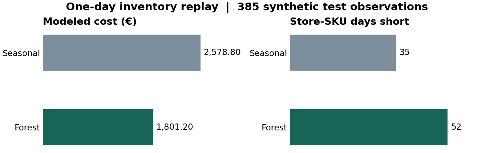
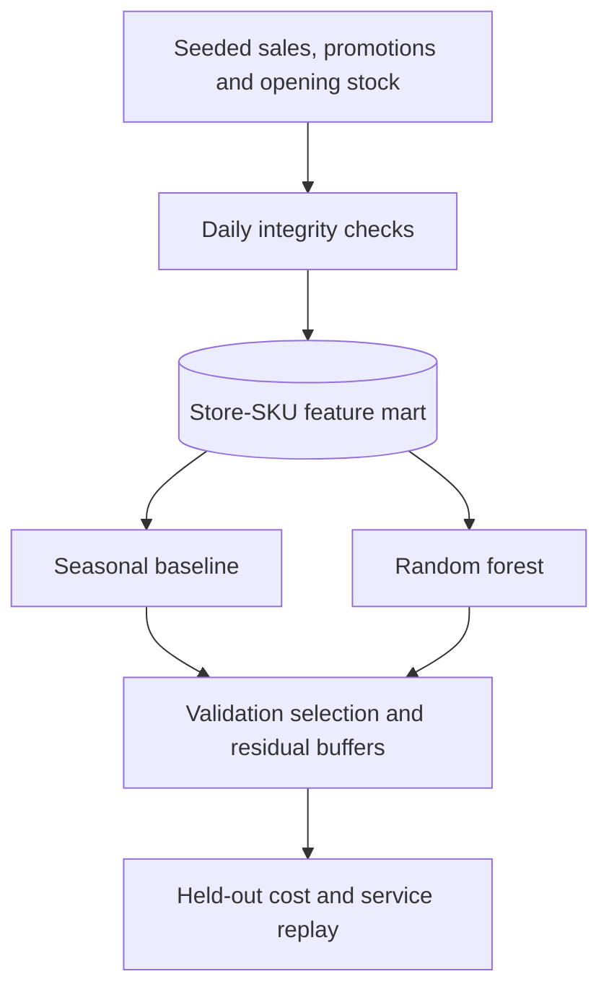

# Retail demand and inventory decisions

**What does a better forecast cost at the shelf?** A retail planner must choose a forecast and a stock buffer. The replay compares both excess and shortage units on the same store, SKU and day. A weighted error metric alone would hide the service trade-off.

Across 385 eligible test store-SKU days, the forest achieved 21.08% weighted absolute percentage error against 28.43% for the seasonal baseline. Under €3.00 per short unit and €0.60 per excess unit, modeled cost fell from €2,578.80 to €1,801.20. Shortage days increased from 35 to 52. **A service-level guardrail could reverse the selection.**



## Try it locally

Use Python 3.12 from the repository root. The demo generates its own synthetic inputs in a temporary directory and prints a decision readout.

```powershell
py -3.12 -m venv .venv
.\.venv\Scripts\python.exe -m pip install ".[dev]"
.\.venv\Scripts\python.exe scripts/demo.py
.\.venv\Scripts\python.exe -m unittest discover -s tests -v
```

On Linux or macOS, use `python3.12 -m venv .venv` and `.venv/bin/python` for the remaining commands. For the persistent example below, activate the environment first with `.\.venv\Scripts\Activate.ps1` in PowerShell or `source .venv/bin/activate` in Bash.

## Persistent example

```shell
retail-run --db retail.sqlite --output artifacts --days 180 --stores 3
```

Open `artifacts/backtest.json` for validation results, test slices and both policy replays. For example, 175 units short × €3.00 plus 2,127 excess units × €0.60 yields €1,801.20. [Full backtest](docs/backtest.json)

## Architecture and methodology



The mart uses lag 1, lag 7 and a trailing seven-day mean. The forecast also sees weekday, planned price and promotion. Cutoffs apply to all series: training ends before May 18, validation ends before June 8 and testing ends June 29, 2026. On validation, choose the lower weighted error and fit a policy-specific residual quantile of 3/(3+0.6). A separate one-day policy replay on test applies a rounded-up stock target to each uncensored observation.

SQLite window functions make feature timing inspectable. A scikit-learn forest can express interactions between calendar and store demand. A one-week seasonal baseline exposes whether the extra complexity buys anything on the same dates.

## Verification and operations

8 automated tests passed locally. The standalone demo ran twice with matching decision outputs. The batch smoke test exercised the full pipeline and replay. The repository includes a GitHub Actions workflow and Docker configuration. Hosted CI and container execution are pending.

The quality gate rejects interior date gaps before any feature replacement. Preserve the input SQLite database and regenerate the mart after repairing inputs. Rerun an identical source configuration for replay. Start a fresh database for a changed simulator configuration. Proposed daily batch objective: deliver one reconciled mart before planner review.

## Limitations and next release

The holdout has no promotion days. Stockouts censor demand, and the replay excludes stockout targets. Each day starts independently with no carryover, delivery lead time, supplier minimums or cross-SKU substitution. This makes the EUR results sensitivity estimates.

Deliver the quality-gated mart first, then validate a baseline, then compare ordering decisions. Before a pilot, run several rolling origins covering promotions, obtain category-specific costs and agree an acceptable shortage rate.

[Product requirements, architecture decision and runbook](docs/design.md) · [Example output](docs/example.json) · [Executed commands and results](docs/verification.txt) · [Interview walkthrough](docs/interview.md)
